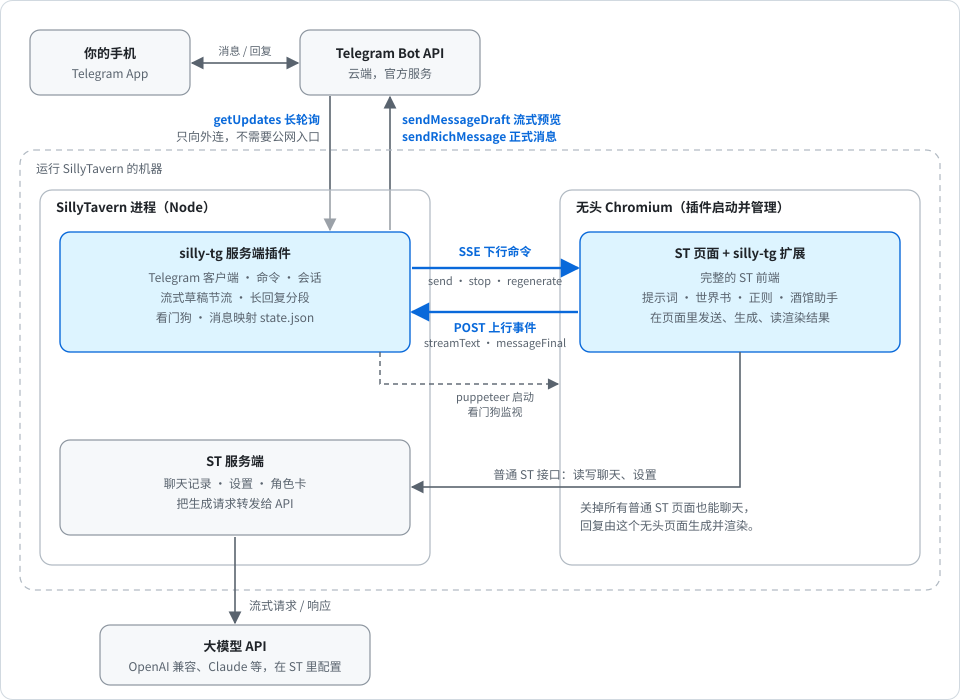

<div align="center">

# silly-tg-bridge-plugin

**在 Telegram 里和 SillyTavern / Luker 的角色聊天**

流式预览 · 富文本回复 · 关掉所有 ST 页面也能用 · 提示词、世界书、正则、酒馆助手照常运行

[](https://github.com/incohua/silly-tg-bridge-plugin/actions/workflows/ci.yml)
[](https://github.com/incohua/silly-tg-bridge-plugin/releases)
[](LICENSE)


[快速开始](#快速开始) · [更新与卸载](#更新与卸载) · [Linux 无头部署](#无头服务器与-linux) · [Bot 命令](#bot-命令) · [配置](#配置) · [工作原理](#工作原理) · [已知限制](#已知限制) · [路线图](ROADMAP.md) · [更新日志](CHANGELOG.md)

</div>

> [!NOTE]
> 这是社区项目，与 SillyTavern、Luker、酒馆助手（JS-Slash-Runner）、Telegram 的官方没有关联。

> [!IMPORTANT]
> **本项目由两部分组成：服务端插件 + UI 扩展，缺一不可。只装 UI 扩展不能用。**
> 服务端插件才是核心（连接 Telegram、管理无头浏览器），UI 扩展负责在无头页面里处理消息。
>
> **服务端插件需要在 ST 的 `config.yaml` 里把 `enableServerPlugins` 改成 `true`。** 它默认是 `false`，不开启时插件根本不会被加载，也不会有任何提示。改完要重启 ST。
>
> 从“安装”一节开始，按步骤做即可。

## 特性

- **流式预览**：生成过程中在 Telegram 里实时显示，预览上有“停止”按钮。
- **富文本正式消息**：用 Telegram 的 Rich Message 发送，对话加粗（可改成斜体或高亮），超长回复自动分段，失败时逐级退回纯文本。
- **ST 原样运行**：回复由真实的 ST 页面生成并渲染，提示词、世界书、正则、酒馆助手、MVU 都照常工作，聊天记录写进 ST 自己的文件。
- **不依赖浏览器标签页**：插件管理一个无头 Chromium，关掉所有 ST 页面也能聊天。
- **省内存**：低内存参数，可设置空闲关闭，收到消息再启动。
- **自动恢复**：看门狗监控页面崩溃、进程退出和心跳超时，自动重启并通知你。
- **只向外连**：通过长轮询访问 Telegram，ST 端口不需要暴露到公网；只有白名单里的账号能使用。

## 工作原理

<div align="center">
  
</div>

插件启动一个无头 Chromium 打开 ST 页面，页面里的 UI 扩展接收插件的指令：发送消息、触发生成、读取渲染结果。两边只通过两条通道通信：插件用 **SSE 下发命令**，页面用 **POST 上报事件**。回复经过“仅格式显示”正则渲染后，转成 Telegram 的 Rich Message 发出。

无头页面的地址是 `http://127.0.0.1:8000/#silly_tg_host=...`。你另开的普通 ST 页面里，这个扩展保持静默，不会重复处理消息。

## 快速开始

### 前提条件

| 项目 | 要求 |
|---|---|
| 酒馆 | SillyTavern 1.19 及以上，或 Luker 的 `release` 分支 |
| 机器 | 一台常开的机器，ST 和 Chromium 都跑在上面 |
| 浏览器 | 系统里装有 Chrome 或 Chromium（也可以在配置里指定路径） |
| 酒馆助手 | 安装 JS-Slash-Runner 并**启用角色脚本**，否则没有 MVU，变量不会初始化。Luker 不自带酒馆助手，需要另外安装 |
| API | 先在普通 ST 页面里配置好并连接一次（无头页面启动时读取已保存的设置并点一次“连接”，不会修改你的 API 设置；之后改了 API 设置，要等无头浏览器下次启动，例如重启 ST 或空闲关闭后再被唤醒，才会用上） |
| Telegram | 用 @BotFather 创建一个 bot，拿到 token；用 @userinfobot 查自己的数字 ID |
| 内存 | 无头 Chromium 加 ST 约 0.8–0.85 GB（macOS 上的粗测，不是保证；Linux 和 2 GB 内存的机器请自己实测）。2 GB 的机器建议保持 `lowMemory: true` 并设置 `idleShutdownMinutes` |

### 安装

有两条路径，装完的结果一样。**推荐路径 A**：先在 ST 里粘贴链接装 UI 扩展，再按页面里的引导补装服务端插件。

#### 路径 A：在 ST 里粘贴链接（推荐）

1. 打开 ST 的“扩展”面板，点 **Install extension**（安装扩展），粘贴本仓库地址 `https://github.com/incohua/silly-tg-bridge-plugin`，安装。
   - 机器上需要装有 git；面板克隆的是仓库默认分支。
   - 这个扩展不会出现在官方的“Download Extensions & Assets”列表里（依赖服务端插件的扩展不被收录），只能这样粘贴链接安装。
   - 重复安装会报“目录已存在”，要先在面板里删除旧的，或直接用“更新”。
2. 安装后在“扩展”设置栏里会出现“Silly TG”，里面提示还需要安装服务端插件。在 ST 根目录执行：

   ```bash
   git clone https://github.com/incohua/silly-tg-bridge-plugin plugins/silly-tg
   ```

   `dist/` 已包含构建产物，不需要安装 pnpm，也不需要构建。命令里的 `plugins/silly-tg` 不能省：不写的话目录会叫仓库名 `silly-tg-bridge-plugin`；用 `pnpm plugins:install` 之类按仓库名克隆的方式也一样，克隆完请把目录改名为 `silly-tg`。**不要在克隆地址里带 token 或密码**：`.git/config` 会保存地址，而 ST 会把 `public/` 下的文件静态公开。
3. 打开 ST 的 `config.yaml`，设置 `enableServerPlugins: true`。**必须开启：不开启时插件根本不会被加载，也不会有任何提示。**
4. 重启 ST，刷新页面，回到“扩展”设置栏的“Silly TG”，填写 Bot Token 和允许的用户 ID，保存。（也可以复制 `plugins/silly-tg/config.example.json` 为 `plugins/silly-tg/config.json` 手动编辑。）
5. 保存配置后再重启一次 ST，日志里应出现 `[silly-tg] Telegram 已连接，bot：@...`。
6. 在 Telegram 里给你的 bot 发 `/status`，确认 Chromium、ST 页面和当前角色正常。
7. 首次使用先发 `/chars` 选择一个角色，再发文字。选过的角色和聊天会被记住，重启后自动恢复。

#### 路径 B：直接 `git clone`，UI 扩展自动部署

1. 在 ST 根目录执行：

   ```bash
   git clone https://github.com/incohua/silly-tg-bridge-plugin plugins/silly-tg
   ```

2. 打开 ST 的 `config.yaml`，设置 `enableServerPlugins: true`。**必须开启，原因同上。**
3. 复制 `plugins/silly-tg/config.example.json` 为 `plugins/silly-tg/config.json`，至少填写 `botToken` 和 `allowedUserIds`。
4. 重启 ST。日志里应出现 `[silly-tg] UI 扩展已部署到 ...` 和 `Telegram 已连接，bot：@...`。
5. 之后同路径 A 的第 6、7 步。

插件启动时会把 UI 扩展自动复制到 `public/scripts/extensions/third-party/silly-tg`，内容没变时不会重复复制。复制失败时日志会给出手动步骤：把 `plugins/silly-tg/dist/extension` 整个目录复制为 `public/scripts/extensions/third-party/silly-tg`，然后重启 ST。配置有误时，插件会在日志里说明要改哪个字段并保持禁用，ST 本身照常启动。

#### 两种方式同时存在时

如果你先走了路径 B，之后又在面板里装了 UI 扩展（或反过来），插件启动时发现 ST 里已有面板安装的副本，会**跳过自动复制**，并清理掉旧的自动部署副本（`third-party/silly-tg`），日志会写明原因。这样 ST 里只加载一份扩展。运行中新装或删除面板副本，要重启 ST 才会重新判断。

UI 扩展和服务端插件的版本应保持一致：版本不一致时服务端日志会警告（不影响连接），请把两边都更新到同一版本。

### 无头服务器与 Linux

没有桌面环境的机器也能用，浏览器是无头运行的，不需要显示器：

- **Debian / Ubuntu 服务器、手机 Termux**：见 [docs/install-linux.md](docs/install-linux.md)（Chromium 安装、沙箱、SSH 隧道、systemd、代理）。Termux 是推断路线，待社区验证。

## Bot 命令

| 命令 | 作用 |
|---|---|
| `/start`、`/help` | 显示命令说明 |
| `/status` | 查看无头浏览器、ST 页面、当前角色和聊天，以及自检结果、看门狗状态 |
| `/stop` | 停止生成，已生成的部分会作为正式消息保留 |
| `/regen` | 重新生成上一条回复；旧回复会被删除，超过 48 小时删不掉时改为标注“已重新生成” |
| `/chars` | 分页按钮选择角色 |
| `/chats` | 分页按钮选择当前角色的聊天 |
| `/preset` | 分页按钮切换当前 API 的预设（对话补全的预设、文本补全的预设等） |
| `/new` | 为当前角色新建聊天；新聊天会自动发出角色的开场白 |
| `/settings` | 在 Telegram 里切换对话样式、生成时预览方式、预览刷新间隔、行动选项按钮排版；点一下切到下一个值，保存到 `config.json` 并立即生效 |
| `/menu` | 主菜单：角色、聊天、预设、新建聊天、重新生成、状态一键入口，附“角色 · 聊天 · 预设”速览 |

在 Telegram 输入框里输入 `/` 会弹出命令菜单。直接发文字就是对角色说话。生成进行中再发消息会收到提示，这条消息不会发给角色，当前生成不受影响。开头是 `/` 的文字会被当作命令。

> [!TIP]
> 流式预览出现时，Telegram 客户端会把发送键换成停止键，所以生成过程中请点预览上的**停止按钮**；`/stop` 在没有流式预览时使用。

### 行动选项按钮

预设让模型在回复末尾给出行动选项（例如 `<SUOT>` 包裹的编号列表）时，选项会变成回复下面一条带数字按钮的消息，点一下就把对应选项发给角色。默认认 `<SUOT>` 和“【行动选项】+ 编号列表”两种写法，其他预设用 `choice-rules.json` 写规则，改完不用重启。详见 [docs/choices.md](docs/choices.md)；用 `pnpm choices:test` 离线试规则，或用 `skills/silly-tg-choice-rules` 让 AI 帮你写。

## 配置

可以在 ST 的**扩展**设置栏里找到“Silly TG”，直接填写 bot token、允许的用户 ID、代理、对话样式等，保存后立即生效或提示重启（每项旁边标明）。也可以手动编辑 `plugins/silly-tg/config.json`（已被 gitignore，不会被提交）；`chromiumPath` 只能在文件里改。

| 键 | 默认值 | 说明 |
|---|---|---|
| `botToken` | 无，必填 | @BotFather 给出的完整 token |
| `allowedUserIds` | 无，必填 | 允许使用的 Telegram 用户数字 ID 数组，例如 `[123456789]`。不在名单里的账号发消息没有任何回应。为空时插件不启动 |
| `dialogueStyle` | `bold` | 对话（带引号的内容）的样式：`bold` 加粗，`italic` 斜体，`mark` 高亮，`plain` 只保留引号 |
| `draftIntervalSeconds` | `1` | 生成时草稿的刷新间隔（秒），0.5–30。聊天窗口上下滚动明显时调大 |
| `draftMode` | `live` | 生成时的草稿：`live` 逐步显示正文，`progress` 只显示“正在生成… 已写 N 字”（不滚动） |
| `choiceLayout` | `numbers` | 行动选项按钮：`numbers` 一排数字按钮，`rows` 每个选项一行并带文字 |
| `stBaseUrl` | `http://127.0.0.1:8000` | 无头 Chromium 访问 ST 的地址。ST 换了端口时修改 |
| `telegramProxy` | 空 | 访问 Telegram 用的代理，见[代理](#代理) |
| `chromiumPath` | 空 | Chrome/Chromium 可执行文件路径。留空时自动查找系统安装位置和 PATH |
| `basicAuth` | `null` | ST 开启了 basic auth 时填 `{"username": "...", "password": "..."}` |
| `idleShutdownMinutes` | `0` | 空闲多少分钟后关闭 Chromium，收到消息时再自动启动。`0` 表示不关闭。生成进行中不会被关闭 |
| `lowMemory` | `true` | 使用低内存 Chromium 参数 |
| `logLevel` | `info` | `debug` / `info` / `warn` / `error` |
| `miniAppPort` | `8788` | Mini App 端口，当前版本未使用 |
| `publicBaseUrl` | 空 | Mini App 的 HTTPS 地址，当前版本未使用 |

### 代理

国内等访问不了 Telegram 的网络，需要配置 `telegramProxy`，例如 `"http://127.0.0.1:7890"`。只支持 `http://` 和 `https://` 代理；代理软件如果只给了 socks 端口，请在软件里找它的 HTTP（混合）端口。

`telegramProxy` 为空时，插件会读取环境变量 `HTTPS_PROXY`、`https_proxy`、`HTTP_PROXY`、`http_proxy`、`ALL_PROXY`、`all_proxy`（按此顺序取第一个非空值）和 `NO_PROXY`；两者都有时以 `telegramProxy` 为准。环境变量里写 socks 等协议会警告并直连。启动日志和 `/status` 会写明代理来源（配置 / 环境变量 / 无），不显示账号密码。注意无头 Chromium 也会继承这些环境变量，ST 地址不是本机时请用 `NO_PROXY` 排除。服务器上的写法见 [docs/install-linux.md](docs/install-linux.md#代理)。

## 已知限制

> [!WARNING]
> **酒馆助手会改写 ST 的全局世界书设置。** 酒馆助手的“强制使用推荐的世界书全局设置”（`extension_settings.tavern_helper.optimize.force_recommended_worldbook_global_settings`，默认开启）会在每次页面加载时，把世界书的 `context_percentage` 改成 100、`include_names` 和 `match_whole_words` 改成 `false` 等，并由 ST 写入 `settings.json`。无头页面每次启动都会加载一次，所以你自己调过的世界书参数会被覆盖，在 ST 里用别的卡时也会看到。
>
> 这是酒馆助手的行为，不用本插件、在普通 ST 页面里同样会发生。想保持自己的世界书设置，请在酒馆助手设置的“优化”里关掉这一项，并重新设一次世界书参数。依赖 MVU 的卡在变量初始化后也会调用 `setLorebookSettings` 强制同样的值，换卡后可能再次被改。想保险，可先备份 `data/<用户>/settings.json`。

> [!WARNING]
> **多端写入风险。** 你另开 ST 页面并在同一个聊天里写入时，可能触发聊天完整性冲突，或互相覆盖。用 Telegram 聊天时，请不要同时在 ST 网页里操作同一个聊天。当前没有多端同步。

> [!CAUTION]
> **不要在 ST 首页地址后面加查询参数**（例如 `?xxx=1`）。ST 1.19 在这种地址下页面会重复，出现两份角色编辑表单，之后新建或打开聊天会把角色卡写坏。无头页面使用 `#` 标记就是为了避开这个问题。若检测到表单重复，`/chats` 和 `/new` 会暂停并在 `/status` 里警告，重启 ST 可恢复。

- 不支持 ST 的多账户模式，不支持群聊。
- 当前版本不支持 swipe、编辑或删除历史消息、发送图片和语音，只处理文字消息。
- `/regen` 只能重新生成 bot 在 Telegram 里发出的上一条回复。
- 流式预览是未经正则处理的原始文字，生成完成后的正式消息才是渲染后的结果。
- 前端卡片（状态栏等）暂时看不到：正文照常发送，卡片的源码代码块会被去掉。截图和 Mini App 见[路线图](ROADMAP.md)。
- 2 GB 内存的机器比较紧，部署后请自己观察。

## 隐私和安全

> [!IMPORTANT]
> **聊天内容会经过 Telegram 服务器，不是端到端加密**（bot 对话不支持端到端加密）。不希望内容经过第三方时不要使用。

- bot token 只保存在服务端的 `config.json` 里，日志中会隐去。不要把 `config.json` 发给别人或提交到仓库。
- 只有 `allowedUserIds` 里的用户可以使用 bot，其他账号发消息不会得到任何回应。
- 扩展栏里的配置面板能修改 `config.json`（含 token 和允许的用户 ID），所以**ST 暴露在局域网或公网时必须开启登录**。面板读取时 token、密码都是掩码，`chromiumPath`（会被当作可执行文件启动）不开放。ST 开启多用户账号时，只有管理员能读写这个面板的接口。
- ST 端口不需要暴露到公网。插件通过长轮询访问 Telegram，不需要公网入口；无头 Chromium 只访问本机的 ST。
- 插件不修改 ST 的文件，也不改变聊天数据格式，最多在 `third-party/silly-tg` 放入扩展（你已通过面板安装时则不放）。

发现安全问题请看 [SECURITY.md](SECURITY.md)。

## 故障排查

日志在 ST 的控制台输出里，所有行以 `[silly-tg]` 开头。需要更多细节时把 `logLevel` 改成 `debug` 后重启。启动时的配置错误会写明字段和改法。

<details>
<summary><b>常见现象</b></summary>

| 现象 | 可能原因 |
|---|---|
| 日志里完全没有 `[silly-tg]` | 没开启 `enableServerPlugins`，或插件目录位置不对 |
| “扩展”设置栏里的 Silly TG 显示“还需要安装服务端插件” | 没装服务端插件，或没开启 `enableServerPlugins`（默认 `false`），或装好后没有重启 ST |
| 面板安装扩展时报错“目录已存在” | 已经装过一份：先在面板里删除旧的，或直接点“更新” |
| 日志提示 UI 扩展与服务端插件版本不一致 | 两边没有一起更新：面板里更新 UI 扩展，同时更新 `plugins/silly-tg`（`git pull`），然后重启 ST |
| 日志提示“扩展没有连接” | 到 ST 的“扩展”管理里确认 Silly TG 存在且没有被停用。面板安装的 `silly-tg-bridge-plugin` 或自动部署的 `silly-tg`，有一份可用就行；两份都没有时，重启 ST 让插件重新部署，或按“安装”一节重新装一份 |
| 日志提示找不到 Chrome/Chromium，或浏览器启动报错 | 安装 Chrome/Chromium，或设置 `chromiumPath`。Linux 服务器见 [docs/install-linux.md](docs/install-linux.md)（Ubuntu 请用 Google Chrome 的 deb，不要用 snap 版）。报错后面的 `💡 修法` 会说明具体怎么改 |
| 连接 Telegram 失败 | 网络访问不了 Telegram，配置 `telegramProxy`（仅支持 HTTP 代理）。代理的配置和验证方法见 [docs/install-linux.md](docs/install-linux.md#代理) |
| 提示“请先发 /chars 选择角色” | 还没选过角色，发 `/chars` 选一个 |
| bot 不回复 | 你的数字 ID 不在 `allowedUserIds` 里，或 token 不对 |
| 第一次启动很久 | 全新的 ST 首次启动有欢迎弹窗，插件会自动点掉，需要等一会 |
| 提示无头浏览器多次异常 | 看看日志里看门狗的原因，修复后再发一条消息即可重试 |

</details>

<details>
<summary><b>自检项（日志里的“页面自检 xxx”和 <code>/status</code>）</b></summary>

| 自检项 | 含义 | 处理办法 |
|---|---|---|
| `csrf` | 无头页面访问需要 CSRF 校验的接口失败。失败时提示词会被组装成空的，**回复会与你的设定无关**，这一项是错误级别。正常情况下几乎不会失败 | 通常说明 ST 首页地址被加了查询参数（例如 `stBaseUrl` 带了 `?...`），或 ST 版本改动了行为。去掉查询参数、重启 ST；仍失败时打开 `logLevel: debug`，带日志反馈 |
| `mvu` | 没有检测到 MVU 变量系统 | 在酒馆助手里启用角色脚本；纯文字对话不受影响 |
| `tavernHelper` | 没有检测到酒馆助手 | 安装并启用 JS-Slash-Runner；Luker 需要单独安装。纯文字对话不受影响 |
| `api` | 当前 API 没有连接，或连接超时 | 在 ST 里配置并连接一次 API，检查地址和密钥 |
| 表单重复字段 | ST 页面出现两份角色编辑表单，`/chats` 和 `/new` 已拒绝执行 | 重启 ST；确认没有给 ST 首页地址加查询参数 |

</details>

<details>
<summary><b>看门狗和空闲关闭的细节</b></summary>

设置了 `idleShutdownMinutes` 后，空闲超时会关闭 Chromium 以节省内存，下一条消息到达时自动重新启动，期间的消息不会丢。

看门狗负责监控：页面崩溃、浏览器进程意外退出、页面连接断开超过 60 秒或心跳超时，都会自动重启 Chromium，并通知白名单用户。短时间内接连出事时等待时间逐次变长（立即、5 秒、30 秒、2 分钟、5 分钟）；连续 5 次之后停止自动重启，直到你再发一条消息时才会重新尝试。ST 退出时会同时关闭 Chromium。

</details>

## 路线图

当前版本（0.1）提供文字对话。接下来的重点是前端卡片的截图和 Mini App、更完整的 Luker 与 Linux 验证，以及对酒馆助手世界书设置的自检提示。Linux 的部署文档已写好，实测结果见路线图。详见 [ROADMAP.md](ROADMAP.md)。

## 更新与卸载

### 更新

UI 扩展和服务端插件各自更新，节奏不同，升级后请两边都检查一下，保持同一版本（版本不一致时服务端日志会警告）。

- **路径 A（面板安装）**：UI 扩展在“扩展”面板里点更新。清单里带 `auto_update`，ST 升级后也会自动更新，并会提示有新版本。服务端插件（`plugins/silly-tg`）是 git 仓库，ST 默认（`enableServerPluginsAutoUpdate: true`）会在启动时自动 `git pull`，也可以手动在目录里 `git pull`，然后重启 ST。
- **路径 B（只 `git clone`）**：`git pull` 更新 `plugins/silly-tg` 后重启 ST，UI 扩展会随插件启动自动覆盖，不需要另外操作。
- **自动部署出来的 `third-party/silly-tg` 不是 git 仓库，不要在面板里点它的“更新”**（会报错）。它随服务端插件更新。

### 卸载

<details>
<summary>展开步骤</summary>

1. 删除 `plugins/silly-tg`。其中的 `data/state.json` 存有消息映射和最近使用的角色、聊天，一并删除。
2. 删除 UI 扩展：在“扩展”面板里删除面板安装的那份；自动部署的 `public/scripts/extensions/third-party/silly-tg` 直接删除目录即可。
3. 如不再需要其他服务端插件，可把 `enableServerPlugins` 改回 `false`。重启 ST。

**只删 UI 扩展而保留服务端插件的话，服务端插件下次启动会重新部署一份**，要彻底去掉请先删 `plugins/silly-tg`。

ST 恢复原状，聊天数据不受影响。

</details>

## 开发与贡献

```bash
pnpm install
pnpm typecheck && pnpm lint && pnpm test && pnpm build
```

欢迎 Issue 和 PR，请先读 [CONTRIBUTING.md](CONTRIBUTING.md)。`dist/` 需要提交：ST 的服务端插件自动更新只做 git 更新，不会构建，用户机器上也不一定有 pnpm。联调用环境变量：`SILLY_TG_CONFIG`（配置文件路径）、`SILLY_TG_OFFLINE=1`（不连接 Telegram）、`SILLY_TG_DATA_DIR`（数据目录）。

## 许可

[AGPL-3.0-only](LICENSE)
